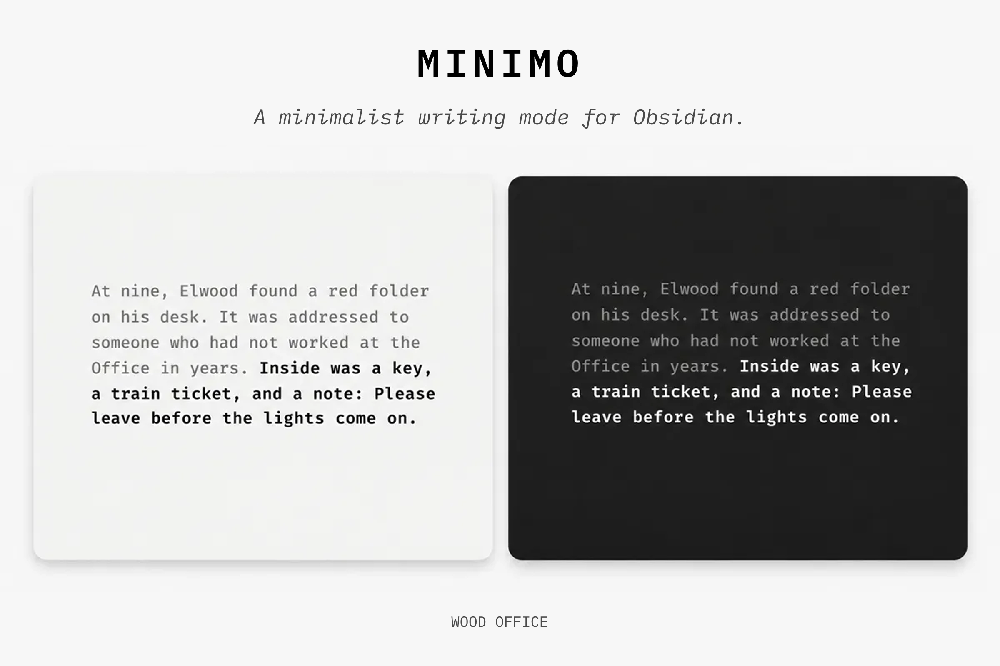

# Minimo

Room to write.

Minimo is a minimalist writing mode for Obsidian. Set a shortcut to step into a quieter view of your note, then return to your workspace without losing your place.

The name comes from *il minimo indispensabile*, an Italian phrase for the least you need. My Olivetti Lettera 32 feels like that to me: a page, a keyboard, and room to hear my own thoughts. I wanted to bring a little of that feeling to Obsidian.



## Use

1. Open a Markdown note in Live Preview in Obsidian.
2. Run **Minimo: Toggle writing view** from the command palette.
3. To add a shortcut, go to **Settings → Community plugins → Minimo → More options → Hotkeys**. This opens Hotkeys filtered to Minimo. None is assigned by default.
4. Run the command again to leave. Escape also works when the editor is active; menus and suggestions keep their usual Escape behavior.

## Writing view

Minimo covers the other panes and app chrome without closing them.

- The note title is hidden by default.
- Headings stay at text size, in bold.
- The cursor and selection stay in place.
- Scrolling works without a visible scrollbar.
- Leaving restores your workspace and its earlier scroll position.

## Settings

**Type.** Choose the included IBM Plex Mono, your system mono font, or a font installed on your computer. If an installed font is unavailable, Minimo uses system mono.

**Page.** Set the type size, line height, line width, title visibility, background, text color, and caret color. The default background follows your Obsidian theme in light and dark mode.

**Focus.** Typewriter scrolling and sentence focus are on by default. Focus dims surrounding text and rendered callouts. Both can be changed or turned off.

## Privacy

No network access or telemetry. Minimo stores its settings through Obsidian and does not edit your Markdown.

## Support

Found a bug? Use the [GitHub issue tracker](https://github.com/woodoffice/obsidian-minimo/issues).

## Development

Minimo supports Obsidian 1.15.0 or newer on desktop and mobile.

```sh
npm install
npm run build
npm run lint
npm test
```

To test locally, copy `main.js`, `manifest.json`, and `styles.css` into `.obsidian/plugins/minimo/` in a separate development vault, then enable Minimo under Community plugins.

## License

Plugin source: MIT. Bundled IBM Plex Mono: SIL Open Font License 1.1. Its notice and terms are in `fonts/OFL.txt` and the release stylesheet.
